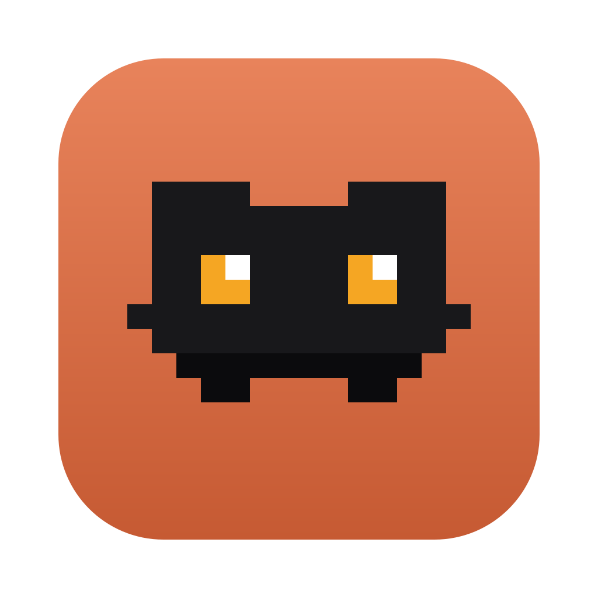

<h1 align="center">
  &nbsp;
  Clotch
</h1>

<p align="center"><b>The goals of your Claude sessions, live in the MacBook notch.</b></p>

Clotch is a macOS app that lives in the notch. Closed, it shows the goal you are chasing now: its state, a progress bar and its proofs. Open, it shows your Claude accounts' usage, every open goal and your requests. It can also speak the end of each Claude turn (ElevenLabs voice). Everything runs on your Mac and reads local files only.

What the app reads and writes, how it is built and how it reaches production: [ARCHITECTURE.md](ARCHITECTURE.md).

## Build

On a Mac with Xcode (macOS 14+):

```bash
./build.sh
open .build/release/Clotch.app
```

`./build.sh --notarize` also notarizes the app and the DMG with the `clotch` notarytool keychain profile.

Linux (goal logic tests only):

```bash
bash scripts/test-goals-linux.sh
```

## Credits

Clotch started as a fork of [CodeIsland](https://github.com/wxtsky/CodeIsland) by wxtsky (MIT): the notch shell, window and motion come from it. License: [LICENSE](LICENSE).
